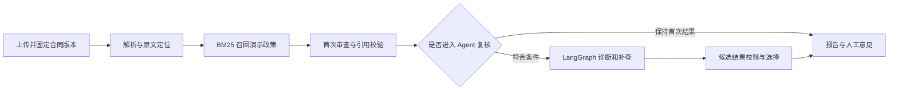

# 采购合同审查原型 · Agentic RAG

一个面向普通货物采购的合同审查演示。上传合同后，可查看结构化审查报告、定位原文与政策片段、查看 Agent 复核过程、保存人工意见并导出报告。

**公开版使用固定模拟响应和虚构政策。** 它展示数据流和工程边界，不提供真实在线审查、法律意见或可签署结论。模拟输出可能与任意上传材料不一致。

## 三分钟上手

需要 Python 3.12 和 PowerShell。从仓库目录执行：

```powershell
.\scripts\setup\initialize.ps1
.\start.ps1
```

打开 [演示首页](http://127.0.0.1:8801/)；也可以直接打开[自编示例报告](http://127.0.0.1:8801/example)。想走一遍流程，可以上传 [虚构采购合同 DOCX](data/examples/contracts/case-01.docx)（[文本源](data/examples/contracts/case-01.txt)），选择审查材料状态，提交后查看带有模拟标记的结果、证据定位和可下载报告。

首次安装需要可用的软件包源。运行演示无需模型密钥、Ollama、Milvus 或 Redis 服务。运行数据保留在 `data/runtime/`，不会随仓库分发。下载 ZIP 时，报告中的全零版本号表示没有可用的 Git 提交号。

## 实现与取舍



- **服务入口**：[`e2e.py`](src/production_rag/e2e.py) 组织上传、报告、意见及导出。
- **证据与引用**：[`contracts/`](src/production_rag/contracts) 保存原文位置；[`knowledge_baseline/`](src/production_rag/knowledge_baseline) 从固定的虚构政策集合检索。
- **Agent 复核**：[`automatic.py`](src/production_rag/agent_review/automatic.py) 定义图流程；[`product.py`](src/production_rag/agent_review/product.py) 布置准入、预算与候选选择。Agent 生成的候选仍需通过校验。

公开快照保留必要的源码、虚构样本和离线回归；不分发第三方文档原件、本地备份或真实运行档案。证据位置匹配也不能单独证明结论正确。

## 验证

```powershell
.\.venv\Scripts\python.exe -m pytest -q
.\.venv\Scripts\python.exe -m ruff check --no-cache src tests scripts
```

测试覆盖合同解析、HTTP 流程、报告、Agent 分支和预算等行为。它们不代表模型准确率或生产环境验收。
